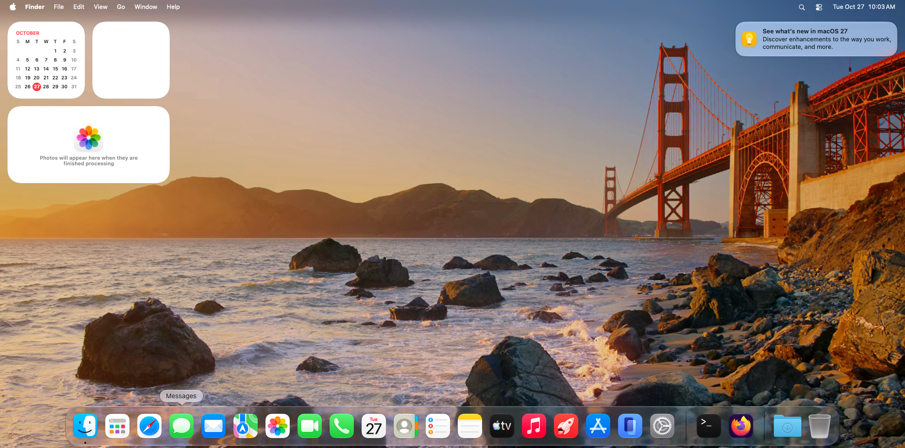

# Golden Gate on QEMU + Reims vGPU

A small Linux x86-64 build and boot project for the supplied macOS 27 Golden
Gate VM (26A428). Bazel downloads pinned QEMU and Reims vGPU (the upstream
spelling of Remis vGPU) sources, applies the patches in `patches/`, and builds
the Linux/Vulkan configuration. The arm64 guest runs on QEMU's `vmapple` machine
through multithreaded TCG; its Metal work runs on the host through reims-vgpu's
Vulkan platform (metal2vulkan) on any Vulkan driver, Mesa lavapipe included.

**Status (2026-10-27):** the guest boots to its login window in about five
minutes and to a working desktop (wallpaper, Finder, Dock with correct icons,
widgets, menu bar extras) about a minute after login in the supplied other-machine verification with
lavapipe. Apps open and render; see [docs/verification.md](docs/verification.md)
for what was checked, with screenshots, and what is still slow or missing.



## What changed from the earlier checkpoint

The project used to pin reims-vgpu `69a57dd` (September) plus 1.3 MB of local
patches. That base reached a desktop only after about an hour, with blank Dock
and app icons and no Terminal text (R32Float colour attachments refused). It is
replaced by upstream reims-vgpu `12adb1fb` (the October rewrite into
`libreims_vgpu` and its C API) and the QEMU fork commit it pins, with two small
patches:

- `patches/qemu-goldengate.patch`: vmapple under TCG on an x86-64 Linux host
  (MAC_PVG for aarch64 TCG, Apple's AES/backdoor/config devices, PSCI, the
  timebase and pointer-authentication compatibility), and macOS 27's virtio
  capability order for `virtio-sound-pci`, so the guest's AppleVirtIOSound
  binds.
- `patches/reims-vgpu-goldengate.patch`: the guest's 16 KiB page size on an
  x86-64 host (`RVG_GUEST_PAGE_SHIFT=14`, IOSurface mapper included),
  Ctrl+Alt+F full-screen switching in the Linux SDL window, and two relaxed
  runtime compatibility fallbacks outside `REIMS_VGPU_STRICT=1` (`MTLSamplerMinMagFilterCubic -> Linear`
  so mipmapped/argument-buffer bicubic draws such as `Weather.app` do not abort
  QEMU, and `sampleCount = 2 -> 4` MSAA promotion on Vulkan drivers such as Mesa
  lavapipe that expose `1x | 4x` MSAA without `2x` so SceneKit/2x-MSAA apps such
  as `Chess.app` render cleanly).

See [patches/UPSTREAM-NOTES.md](patches/UPSTREAM-NOTES.md).

## Build

Requires Linux x86-64, Bazel 9.1.0, rustup (the reims-vgpu checkout pins Rust
1.98.1 in `rust-toolchain.toml`), clang and lld (the dist step always builds the
PCI option ROM), CMake (SDL3), GCC, Python 3.11+, Meson, Ninja, pkg-config,
GLib, Pixman, libslirp, libfdt, zstd, PulseAudio client headers and Vulkan.

```sh
sudo apt-get install build-essential clang lld cmake ninja-build meson pkg-config \
  libglib2.0-dev libpixman-1-dev libslirp-dev libfdt-dev libzstd-dev libpulse-dev \
  libvulkan-dev mesa-vulkan-drivers python3-pil ffmpeg xclip
bazel build //:qemu
```

`tools/build.py` runs `cargo xtask dist` with `RVG_GUEST_PAGE_SHIFT=14`;
`LLD=/path/to/lld` selects an lld when none is on `PATH`. Cargo fetches
metal2vulkan at the commit reims-vgpu's `Cargo.lock` names. Outputs are
`bazel-bin/qemu-dist/{qemu-system-aarch64,qemu-img}` and
`bazel-bin/remis_vgpu-dist/` (static library, header, pkg-config file and
license texts).

## Private assets and boot

Keep Apple firmware, AUX/NVRAM, guest disks and runtime state outside this
repository. The default sibling directory uses the checkout's name:

```text
../<checkout-name>-local/
  assets/
    AVPBooter.vmapple2.bin
    aux.block.img
    ECID.txt
    GoldenGate-27.0-26A428.img   # local sparse copy or symlink to supplied disk
  runtime/
    <UTC timestamp>/          # writable overlay, copied AUX, logs, QMP
    latest -> <UTC timestamp>
```

See [constructing guest images](docs/guest-images.md) for the preparation
procedure.

```sh
python3 tools/vm.py launch            # window on $DISPLAY, guest mode = host screen size
python3 tools/vm.py launch --full-screen
python3 tools/vm.py launch --headless # VNC and QMP only
python3 tools/vm.py launch --continue-from ../<checkout-name>-local/runtime/<stopped run>
python3 tools/vm.py status | screenshot OUT.png | key ret | type --file F | click X Y | stop
```

The launcher defaults to eight vCPUs, 8 GiB of guest RAM shared through
`/dev/shm`, lavapipe, user-mode NAT networking with guest SSH forwarded to
`127.0.0.1:10022`, VNC on `127.0.0.1:5901`, and a `virtio-sound-pci` device on
the host's PulseAudio (PipeWire's pulse server works).

- **Window and resolution.** Each guest display opens in reims-vgpu's SDL3
  window. `--resolution auto` (the default) offers the guest the host screen's
  size (`xdpyinfo`), so a full-screen window shows one guest pixel per screen
  pixel; `--resolution WxH` or `host` choose otherwise. Click into the window to
  capture the keyboard and pointer; **Ctrl+Alt+Super** releases them and
  **Ctrl+Alt+F** switches between windowed and full screen at any time.
- **Clipboard.** macOS has no SPICE agent, so `tools/clipboard.py` bridges the
  host's X11 clipboard and the guest's pasteboard over SSH (`pbcopy`/`pbpaste`).
  Enable Remote Login in the guest once, then
  `python3 tools/clipboard.py setup` (installs your SSH key) and
  `python3 tools/clipboard.py run`.
- **Guest settings.** `python3 tools/guest_setup.py all` replaces the default
  Aerial video wallpaper with a still of the same scene and turns off display
  sleep and the screen lock; see "Known limitations".

Each launch creates a new QCOW2 overlay; `--continue-from` chains it onto a
stopped run so the guest keeps its first-login setup and settings. Stop a live
VM before launching another.

## Known limitations

- TCG is roughly an order of magnitude slower than Apple hardware. macOS
  services with fixed timeouts notice:
  - `WallpaperAgent` gives each wallpaper extension about 30 s to connect and
    launches every installed provider after a login, while the default Golden
    Gate wallpaper is a 460 MB 4K 10-bit HEVC Aerial video decoded in software,
    so the desktop can stay black for several minutes before falling back.
    `tools/guest_setup.py wallpaper` replaces the Aerial provider with its
    extracted still image so the wallpaper appears immediately.
  - Safari 27 renders its window chrome and Start Page cleanly, but enforces a
    hardcoded 3 s `ResponsivenessTimer` on `com.apple.WebKit.GPU`
    (`GPUProcessProxy::didBecomeUnresponsive`) when navigating external pages;
    under TCG `GPUProcess` initialization (`LaunchServices` + `CoreAudio` / TCC
    check-in) takes ~4.4 s, leaving external tab content blank. Firefox
    (`Firefox.app`, Gecko + WebRender) has no 3 s GPU-process watchdog and
    renders web pages and streams YouTube video and stereo audio cleanly.
- Outside `REIMS_VGPU_STRICT=1`, runtime `MTLSamplerMinMagFilterCubic` samplers
  are approximated with `Linear` filtering so mipmapped/argument-buffer bicubic
  draws do not hit `metal2vulkan`'s unmeasured-state refusal, and 2-sample MSAA
  descriptors/pipelines are promoted to 4 samples when the Vulkan driver
  supports `4x` MSAA without `2x` MSAA (as Mesa lavapipe does, while PVG's
  scalar `maxSampleCount = 4` device-info key implies `2x` support to the guest).
- The guest's Keyboard Setup Assistant appears on the first login (QEMU's USB
  keyboard has no Apple identity); quit it once.

## Layout and provenance

- `MODULE.bazel`, `build_defs/`: pinned external sources and Bazel build rules.
- `patches/`: source changes applied to the pinned upstreams.
- `tools/`: build drivers, VM launcher/QMP utilities, clipboard bridge, guest settings.
- `licenses/`: upstream notices and collected dependency license texts.
- `docs/`: guest image preparation, verification record and screenshots.

Project build/launch code is GPL-2.0-or-later; upstream files and patches retain
their original terms. See [license inventory](licenses/README.md).

Before committing documentation or generated evidence, run
`python3 tools/check_public_tree.py`.
