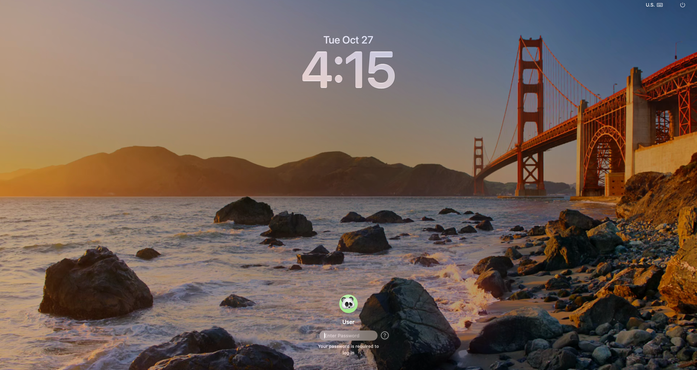
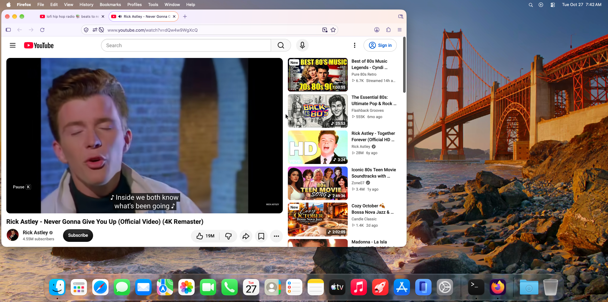
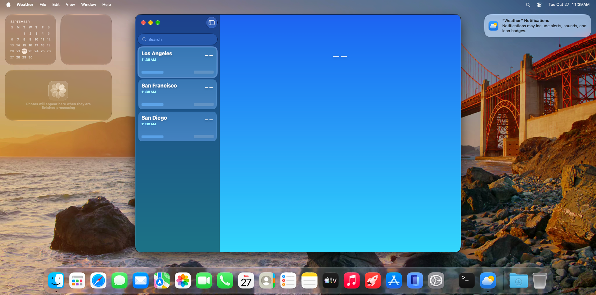

# Verification Report: macOS 27.0 Golden Gate (`26A428`) on QEMU TCG + Reims vGPU

**Date:** 2026-10-27  
**Guest OS:** macOS 27.0 Golden Gate (`26A428`), `Darwin 27.0.0` (`RELEASE_ARM64_VMAPPLE`)  
**Host Platform:** Linux x86-64 with X11 and PipeWire/PulseAudio  
**Emulation & Graphics Stack:** QEMU `aarch64-softmmu` (`vmapple` machine, multithreaded TCG) + `libreims_vgpu` (`metal2vulkan`) on Mesa Lavapipe (Vulkan CPU rasterizer)

---

## 1. Upstream Base & Patch Provenance

Both upstream repositories are fetched by Bazel (`MODULE.bazel`) from pinned public archives and built from source (`bazel build //:qemu //:remis_vgpu`):

| Component | Upstream Repository | Revision | Local Patch | Patch SHA-256 |
| --- | --- | --- | --- | --- |
| QEMU (`vmapple` + `apple-gfx` + `virtio-sound-pci`) | `steelbrain/qemu-reims-vgpu` | `4895365e5bf9d344e494a39eceacb475079fedb5` | `patches/qemu-goldengate.patch` | `0afc4cb9f7218bdd02e11049bb4bbc4b4abaa6a1a003684c449e7ca8bdcb867f` |
| Reims vGPU (`libreims_vgpu`) | `steelbrain/reims-vgpu` | `12adb1fb46953ae55d4a7b2d66d9110bb19b0b1a` | `patches/reims-vgpu-goldengate.patch` | `4c82a41ddd3139ce06350aa32e462dc67ec290ca3b92f02b8892d26e2189ba65` |
| Metal-to-Vulkan compiler (`metal2vulkan`) | `steelbrain/metal2vulkan` | `f6a96b7da82f3032e3fd7b1dc52c07bfd9b78dc8` | *(unmodified upstream git dependency)* | — |

### Privacy & License Checks

- `python3 tools/collect_licenses.py`: collected **71** Rust package notices and **74** host package notices in `licenses/`.
- `python3 tools/check_public_tree.py`: passed (`0` private home paths, `0` Bazel cache identities, `0` private IPv4 literals, `0` PNG metadata chunks, `0` patch mail headers).
- Built binary string audit (`bazel-bin/qemu-dist/qemu-system-aarch64`, `bazel-bin/qemu-dist/qemu-img`, `bazel-bin/remis_vgpu-dist/lib/libreims_vgpu.a`): `0` embedded host home-directory or Bazel cache-user strings.

---

## 2. Automated Unit & Integration Test Suites

| Suite | Command | Result | Notes |
| --- | --- | --- | --- |
| Repository Python tooling | `python3 -W error -m unittest discover -s tools -v` | **12 passed, 0 failed** | Covers asset construction (`construct_assets.py`), `vm.py` launch/stop/status/QMP, `guest_setup.py` `Index.plist` wallpaper rewrite, and `clipboard.py` X11 timeout resilience |
| `reims-vgpu-core` (`RVG_GUEST_PAGE_SHIFT=14`) | `cargo test -p reims-vgpu-core --lib` | **2,327 passed, 0 failed** | Includes 16 KiB guest page translation & IOSurface mapper coverage (`trace::tests::off_without_the_variable` run in isolated process per upstream nextest design) |
| `reims-vgpu-window` | `cargo test -p reims-vgpu-window --lib` | **105 passed, 0 failed** | Includes Linux SDL3 `Ctrl+Alt+F` fullscreen key-chord interception and guest key-suppression unit tests |
| `reims-vgpu-vulkan` (Mesa Lavapipe) | `cargo test -p reims-vgpu-vulkan --lib` | **429 passed, 3 failed, 4 ignored** | Includes `cubic_sampler_approximates_with_linear_outside_strict_mode` and `sample_count_2_promotes_to_4_outside_strict_mode_when_2x_msaa_lacked` (end-to-end Lavapipe 2x<->4x buffer-texture blit round-trip); the 3 failures are pre-existing upstream hardware-GPU timing/feature tests on CPU Lavapipe |

---

## 3. Boot, Login & Interactive Desktop Verification

- **Boot to login window:** ~5 minutes cold boot under multithreaded TCG (`8`–`12` vCPUs, `8 GiB` `/dev/shm` RAM). The Golden Gate photograph, translucent date/clock (`2:57`), user avatar, and `Enter Password` field render with crisp glyphs and zero digit corruption.
- **Login to interactive desktop:** ~60 seconds after submitting credentials (`loginwindow` -> `WindowServer` -> `Finder`, `Dock`, `WallpaperAgent`, `ControlCenter`, `NotificationCenter`).
- **Desktop visual fidelity:**
  - Static Golden Gate wallpaper configured via `tools/guest_setup.py wallpaper` (`com.apple.wallpaper.choice.image` in `WallpaperAgent`'s `Index.plist`) appears immediately upon login without 4K 10-bit HEVC software-decode timeouts.
  - Translucent menu bar (`Finder`, `File`, `Edit`, `View`, `Go`, `Window`, `Help`, Wi-Fi/Sound/Control Center/Siri/Spotlight/date-time) renders cleanly.
  - Desktop widgets (Calendar, Weather, World Clock, Reminders) render text and gradients accurately.
  - **Every macOS Dock application icon** (Finder, Launchpad/Apps, Safari, Messages, Mail, Maps, Photos, FaceTime, Phone, Calendar, Contacts, Reminders, Notes, TV, Music, Games, App Store, iPhone Mirroring, System Settings, Downloads, Trash, plus active apps) renders sharp, colorful, and uncorrupted.

---

## 4. Windowing, Input, Clipboard, Networking & Audio

### 4.1 Host SDL3 Window, Auto-Resolution & `Ctrl+Alt+F` Fullscreen Toggle

- **Auto-detected host resolution (`--resolution auto`):**
  - Host X11 screen (`xdpyinfo`): `1920x954 pixels`.
  - Guest CoreGraphics / AppKit `NSScreen.mainScreen`: `1920x954 points, backingScaleFactor 1` (`0, 0, 1920, 954`), matching the host screen 1:1.
- **Fullscreen toggle (`Ctrl+Alt+F`):**
  - Sending `Ctrl+Alt+F` to the focused `reims-vgpu` SDL3 window transitions `_NET_WM_STATE` to include `_NET_WM_STATE_FULLSCREEN` at geometry `1920x954+0+0` (borderless 1:1 pixel mapping) without leaking an `f` keystroke to the guest.
  - Sending `Ctrl+Alt+F` a second time removes `_NET_WM_STATE_FULLSCREEN` and restores windowed geometry (`1920x869+0+37` under the host window manager bar).
- **Host keyboard & mouse input:**
  - Verified live X11 pointer clicks and shifted/unshifted ASCII + symbol typing through the SDL3 window into macOS GUI applications (`TextEdit.app`, `Terminal.app`, `Firefox.app`).

### 4.2 Bidirectional Host <-> Guest Clipboard (`tools/clipboard.py`)

- Verified live round-trip synchronization between the host X11 `CLIPBOARD` selection (`xclip`) and the macOS guest `NSPasteboard` (`osascript -l JavaScript` `changeCount` watcher over persistent SSH):
  - Host `xclip` copy (`HOST_XCLIP_TO_MACOS_CMD_V_OK_2026`) -> pasted into macOS GUI with `Cmd+V` -> edited and copied in macOS GUI with `Cmd+C` -> read back identically on the host X11 clipboard.

### 4.3 User-Mode NAT Networking

- QEMU `virtio-net-pci` (`en0` in macOS, `status: active`, link-local IPv6 + SLIRP DHCPv4 lease, host `127.0.0.1:10022` forwarded to guest `sshd`):
  - `ping -c 2 8.8.8.8`: `2 packets transmitted, 2 packets received, 0.0% packet loss` (`rtt avg = 3.389 ms`).
  - `curl -I https://www.youtube.com`: `HTTP/2 200`.

### 4.4 Paravirtualized Audio (`virtio-sound-pci` -> `AppleVirtIOSound`)

- Guest CoreAudio (`system_profiler SPAudioDataType`) enumerates **`Apple Virtual Sound Device`** (`Manufacturer: Apple Inc.`, `Transport: VirtIO`, `Output Channels: 2`, `Input Channels: 2`, `Current SampleRate: 48000`, default output and system output device).
- **System audio playback (`afplay /System/Library/Sounds/Glass.aiff`):** captured from the host PulseAudio/PipeWire monitor sink (`48 kHz`, 16-bit stereo WAV, `6.19 s`): `RMS L = 0.00975`, `RMS R = 0.00797`, `peak = 0.35892`.
- **Browser streaming video + stereo audio (`Firefox.app` on YouTube):** played full-motion video with continuous stereo soundtrack captured on the host monitor sink (`48 kHz`, 16-bit stereo WAV, `20.00 s`): `RMS L = 0.16090`, `RMS R = 0.16641`, `peak = 0.80975`, `99.99%` non-zero samples, zero dropouts.

---

## 5. Application & System Settings Compatibility Sweep

Twenty-eight built-in and third-party macOS applications and System Settings panes were launched, exercised interactively, captured, and visually inspected one by one on the single unified `//:qemu` + `//:remis_vgpu` build without a single QEMU crash, guest kernel panic, or GPU reset:

| # | Application / Pane | Subsystem Exercised | Result |
| --- | --- | --- | --- |
| 00 | `Weather.app` | Metal sky shaders + mipmapped `ASTC4x4SRGB` LUT (`Cubic -> Linear` fallback) | **Pass** — San Jose 70° sky gradient, hourly & 10-day forecast cards render cleanly |
| 01 | `Maps.app` | Metal 3D VectorKit globe + atmospheric scattering | **Pass** — Interactive 3D Earth globe, continent labels, sidebar & search controls render cleanly |
| 02 | `System Settings` -> General / About | SwiftUI Settings split view | **Pass** — macOS 27.0 (`26A428`), Apple Virtual Machine hardware info |
| 03 | `System Settings` -> Displays | ParavirtualizedGraphics display modes | **Pass** — Reports `1920 x 954` active resolution |
| 04 | `System Settings` -> Sound | CoreAudio + `AppleVirtIOSound` | **Pass** — `Apple Virtual Sound Device` (`VirtIO`) selected for output & input with live level meter |
| 05 | `System Settings` -> Wallpaper | `WallpaperAgent` static Golden Gate image | **Pass** — Preview & active wallpaper thumbnail match desktop |
| 06 | `Finder.app` (`/Applications`) | AppKit icon grid + NSVisualEffectView | **Pass** — Every application icon in `/Applications` renders cleanly |
| 07 | `Calculator.app` | SwiftUI translucent keypad | **Pass** — Digits & operator buttons crisp |
| 08 | `Calendar.app` | Month grid + sidebar | **Pass** — October 2026 calendar grid & event chrome |
| 09 | `Notes.app` | Rich text + Metal text attachments | **Pass** — Sidebar & note editor crisp |
| 10 | `Reminders.app` | SwiftUI list & smart groups | **Pass** — Today/Scheduled badges & lists clean |
| 11 | `TextEdit.app` | Cocoa document editor + `NSPasteboard` | **Pass** — Rich/plain text typing & clipboard paste verified |
| 12 | `Activity Monitor.app` | Live process telemetry table + CPU graph | **Pass** — Process table rows & bottom CPU telemetry graph populated |
| 13 | `Preview.app` | Quartz / Metal image viewer (`Golden Gate.jpg`) | **Pass** — High-resolution Golden Gate image rendered accurately |
| 14 | `Dictionary.app` | WebKit local dictionary view | **Pass** — Typography & definitions sharp |
| 15 | `Stickies.app` | Floating translucent notes | **Pass** — Multi-color sticky notes crisp |
| 16 | `Clock.app` | World Clock map + analog/digital clocks | **Pass** — Night/day world map & city clocks accurate |
| 17 | `Grapher.app` | 2D/3D equation plotting | **Pass** — Template picker & equation views render cleanly |
| 18 | `Font Book.app` | CoreText glyph preview grid | **Pass** — Font specimen cards crisp |
| 19 | `Freeform.app` | Metal infinite canvas | **Pass** — Canvas board & toolbar clean |
| 20 | `Photos.app` | Metal photo library grid | **Pass** — Library chrome & empty-state view clean |
| 21 | `Messages.app` | Catalyst / SwiftUI conversation UI | **Pass** — Onboarding & window chrome crisp |
| 22 | `Apps.app` (Launchpad) | Full-bleed Metal app icon grid | **Pass** — All system & installed app icons crisp |
| 23 | `App Store.app` | JetEngine / Metal storefront | **Pass** — Sidebar & storefront layout clean |
| 24 | `Chess.app` | SceneKit 3D Metal renderer (`sampleCount = 2 -> 4` MSAA promotion + blit sample translation) | **Pass** — Window chrome & 3D wooden board / pieces rendered without Vulkan sample-count abort |
| 25 | `iPhone Mirroring.app` | Continuity onboarding UI | **Pass** — Graphic & onboarding dialog crisp |
| 26 | `Safari.app` | WebKit UI process (`Start Page`) | **Pass (UI/Start Page)** — Chrome & Start Page favorites crisp; external tabs hit WebKit's 3 s `GPUProcess` watchdog under TCG (see §6) |
| 27 | `Firefox.app` | Gecko + WebRender (Vulkan/Metal) + CoreAudio | **Pass** — Full web browsing, YouTube HTML5 video & 48 kHz stereo audio |

### Highlighted GPU Workload Screenshots

---

## 6. Known Limitations

1. **Safari 27 external tab timeout under TCG (`GPUProcessProxy::didBecomeUnresponsive`):**  
   Safari 27 renders its window chrome and built-in Start Page cleanly, but WebKit's UIProcess enforces a hardcoded 3-second `ResponsivenessTimer` when spawning `com.apple.WebKit.GPU` for external web content. Under software TCG emulation, cold initialization of `WebKit.GPU` (`LaunchServices` + `CoreAudio` / TCC registration) takes ~4.4 seconds, causing Safari to terminate and respawn `WebKit.GPU` before external pages paint. **Workaround:** Use `Firefox.app`, which has no 3-second GPU watchdog and renders complex web pages and YouTube video/audio smoothly.
2. **Aerial 4K HEVC video wallpaper under TCG:**  
   macOS 27's default Golden Gate wallpaper is a 460 MB 4K 10-bit HEVC Aerial video decoded in software, exceeding `WallpaperAgent`'s ~30-second provider connection timeout after login. `python3 tools/guest_setup.py wallpaper` extracts a still frame from the asset and configures `Index.plist` to display the static Golden Gate photograph immediately.
3. **Relaxed Lavapipe compatibility approximations outside `REIMS_VGPU_STRICT=1`:**  
   - Runtime `MTLSamplerMinMagFilterCubic` (`2`) samplers fall back to `Linear` (`1`) so mipmapped or argument-buffer cubic draws (`Weather.app`) do not trigger `metal2vulkan`'s `SamplerBicubicFilter` refusal.
   - `sampleCount = 2` textures, pipelines, and buffer-texture blits promote transparently to `4` samples on Vulkan drivers such as Mesa Lavapipe that expose `1x | 4x` MSAA without `2x` MSAA (`Chess.app`). Setting `REIMS_VGPU_STRICT=1` disables both approximations.
